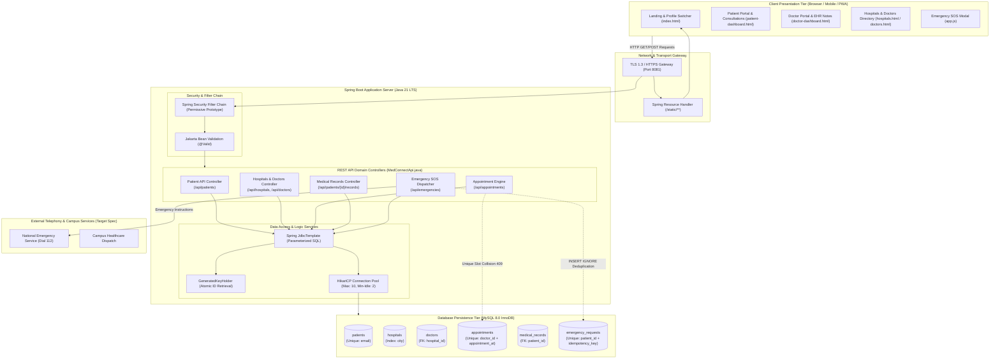
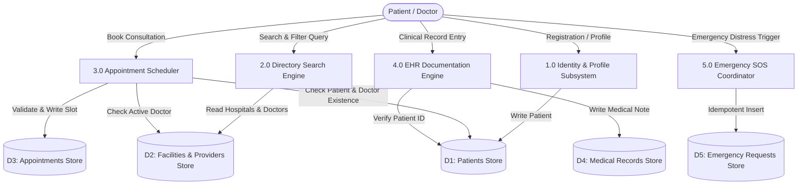
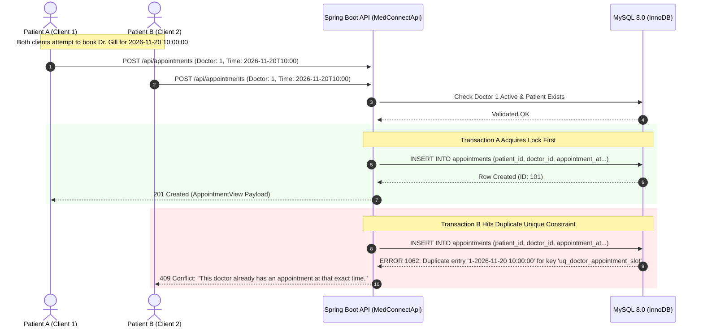
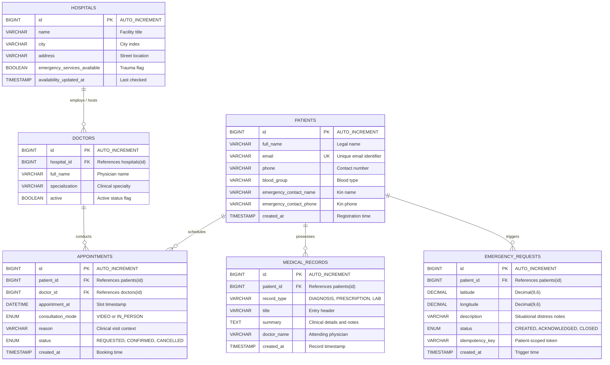
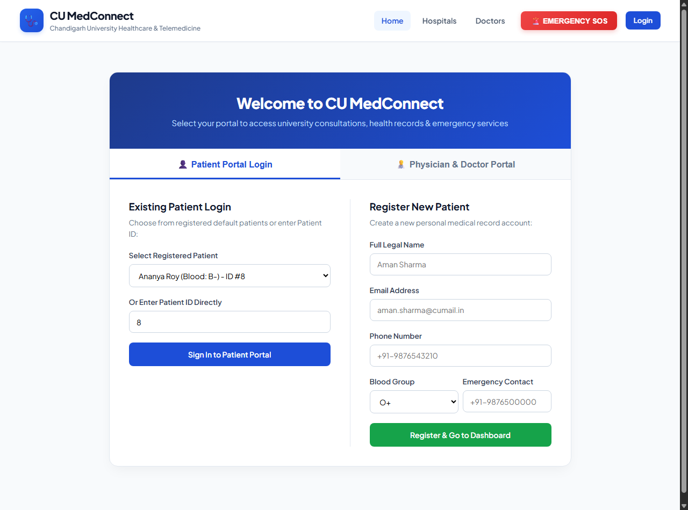
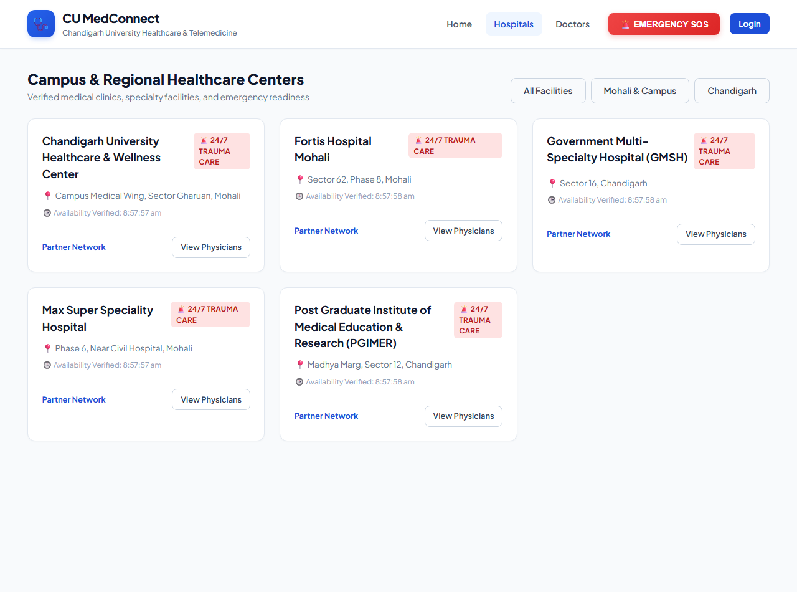
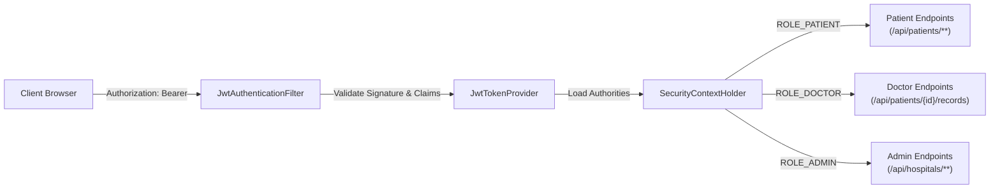
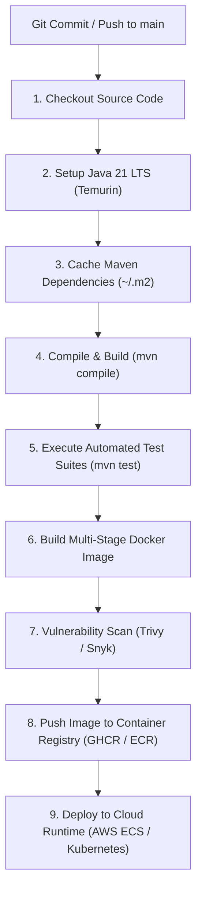

# CU-MEDCONNECT: SMART CAMPUS HEALTHCARE & TELEMEDICINE COORDINATION PLATFORM

---

### **A PROJECT REPORT**

**Submitted in partial fulfillment of the requirements for the degree of**  
**Bachelor of Engineering in Computer Science and Engineering**

**Submitted by:**  
- **Pratik Vats** – `24bcs10343`  
- **Aditya Singh** – `24bcs10266`  
- **Prakash Shukla** – `24bcs10259`  
- **Shitanshu Shekhar** – `24bcs10127`  
- **Tarun Sharma** – `24bcs10081`  

**Department of Computer Science and Engineering**  
**Chandigarh University, Gharuan, Mohali, Punjab – 140413**  
**Academic Year: 2026–2027**

---

```
========================================================================================
                                 CANDIDATE DECLARATION
========================================================================================
We hereby certify that the work presented in this Project Report entitled "CU MedConnect:
Smart Campus Healthcare & Telemedicine Coordination Platform", in partial fulfillment
of the requirements for the award of Bachelor of Engineering in Computer Science and
Engineering, submitted to the Department of Computer Science and Engineering,
Chandigarh University, is an authentic record of our own work carried out under
academic supervision.

Signatures of Candidates:

1. Pratik Vats (24bcs10343)         _____________________
2. Aditya Singh (24bcs10266)        _____________________
3. Prakash Shukla (24bcs10259)      _____________________
4. Shitanshu Shekhar (24bcs10127)   _____________________
5. Tarun Sharma (24bcs10081)        _____________________

Date: 16-November-2026
Place: Chandigarh University, Mohali
========================================================================================
```

---

## TABLE OF CONTENTS

1. **Executive Summary / Abstract**
2. **Team Contribution & Responsibilities Matrix**
3. **Chapter 1: Project Overview & Problem Definition**
   - 1.1 Introduction & Background
   - 1.2 Motivation & Industry Context
   - 1.3 Problem Statement & Current Campus Deficiencies
   - 1.4 Objectives of the Project
   - 1.5 System Boundaries, Scope, and Medical Disclaimer
   - 1.6 Stakeholder Profiles
4. **Chapter 2: Requirements Engineering & Specification**
   - 2.1 Functional Requirements (FR-01 to FR-22)
   - 2.2 Non-Functional Requirements (NFR-01 to NFR-12)
   - 2.3 Regulatory, Compliance & Ethics Analysis (DISHA, HIPAA, Telemedicine 2020)
   - 2.4 User Persona & User Journey Maps
5. **Chapter 3: Project Estimations, Sizing & Feasibility Analysis**
   - 3.1 Software Sizing via Function Point Analysis (FPA)
   - 3.2 COCOMO II Effort & Schedule Estimation
   - 3.3 Work Breakdown Structure (WBS) & Sprint Allocation
   - 3.4 Cloud Infrastructure & Hardware Cost Projections
   - 3.5 Project Timeline & Milestone Gantt Mapping
6. **Chapter 4: System Architecture & High-Level Design (HLD)**
   - 4.1 Architectural Paradigms & System Context
   - 4.2 Comprehensive High-Level System Architecture Diagram (Mermaid)
   - 4.3 Subsystem Deconstruction & Layered Decomposition
   - 4.4 Data Flow Diagrams (DFD Level-0, Level-1, Level-2)
   - 4.5 System Sequence Diagrams & Concurrency Model
   - 4.6 Idempotency Engine & Double-Booking Protection Mechanism
7. **Chapter 5: Detailed API Specification & Interface Contracts**
   - 5.1 RESTful Architecture & Protocol Conventions
   - 5.2 Patient Management API Endpoints
   - 5.3 Hospital & Healthcare Directory API Endpoints
   - 5.4 Specialist & Doctor Management API Endpoints
   - 5.5 Appointment Scheduling & Conflict Resolution API Endpoints
   - 5.6 Electronic Health Records (EHR) API Endpoints
   - 5.7 Emergency SOS Coordination & Safety API Endpoints
   - 5.8 Error Handling Matrix & HTTP Status Code Mapping
8. **Chapter 6: Database Architecture & Data Dictionary**
   - 6.1 Database Design Philosophy & Schema Normalization (1NF to BCNF)
   - 6.2 Entity-Relationship (ER) Diagram (Mermaid)
   - 6.3 Relational Schema & Full DDL Specification with Verified Seed Data
   - 6.4 Comprehensive Data Dictionary
   - 6.5 Indexing Strategy, Query Optimization, and HikariCP Tuning
9. **Chapter 7: User Interface Design & Walkthrough (With New Screenshots)**
   - 7.1 Front-End Architecture & Modern Design Language
   - 7.2 UI Walkthrough 1: Role-Based Authentication & Profile Selector (`mpa-login.png`)
   - 7.3 UI Walkthrough 2: Healthcare Facilities & Hospital Directory with Municipal Filters (`mpa-hospitals.png`)
   - 7.4 UI Walkthrough 3: Patient Consultation Booking & Status Tracker
   - 7.5 UI Walkthrough 4: Physician Portal & Medical History Formulation
   - 7.6 UI Walkthrough 5: Emergency SOS Modal with Geographic Coordinates
10. **Chapter 8: Security, Vulnerability Analysis & Hardening**
    - 8.1 Current Prototype Security Posture
    - 8.2 OWASP Top 10 Threat Modeling & Vulnerability Remediation
    - 8.3 Data Protection at Rest (AES-256) & In Transit (TLS 1.3)
    - 8.4 Enterprise RBAC & Spring Security Implementation Roadmap
    - 8.5 Legal Safeguards & Emergency Dispatch Disclaimer Architecture
11. **Chapter 9: Testing, Verification & Quality Assurance**
    - 9.1 Verification Strategy & Test Pyramid
    - 9.2 Comprehensive Test Cases & Scenarios Matrix (TC-01 to TC-28)
    - 9.3 Concurrency & Race-Condition Verification
    - 9.4 Static Code Analysis & Code Quality Findings
12. **Chapter 10: DevOps, Deployment & CI/CD Pipeline**
    - 10.1 Build Configuration & Dependency Management (Maven, Java 21 LTS)
    - 10.2 Multi-Stage Docker Containerization
    - 10.3 Automated CI/CD Pipeline Architecture
    - 10.4 Environment Parameterization & Secret Management
13. **Chapter 11: Future Enhancements & Production Roadmap**
    - 11.1 Phase 1: OAuth2/OIDC & Enterprise Multi-Tenant RBAC
    - 11.2 Phase 2: WebRTC Peer-to-Peer Teleconsultation Rooms
    - 11.3 Phase 3: Wearable IoT Integration & Real-time GPS Ambulance Dispatch
    - 11.4 Phase 4: AI Clinical Decision Support & Symptom Triage
    - 11.5 Phase 5: National Digital Health Mission (ABHA) Interoperability
14. **Chapter 12: Conclusion**
15. **References & Bibliography**
16. **Appendix: System Configuration & Sample Payloads**

---

## 1. EXECUTIVE SUMMARY / ABSTRACT

Higher education campuses with tens of thousands of residential students, faculty, and administrative staff function as self-contained micro-cities. Within these environments, healthcare logistics frequently suffer from operational fragmentation: students encounter long dispensary queues, opaque physician consultation schedules, fragmented or non-existent digital health histories, and a lack of standardized emergency channels during critical campus incidents. 

**CU MedConnect** is an integrated, full-stack campus telemedicine and emergency coordination prototype developed specifically to bridge these logistical deficiencies. Built upon a high-performance **Java 21 LTS** and **Spring Boot (v4.x)** micro-architecture coupled with a normalized **MySQL 8.0** relational datastore and a responsive browser-based single-page interface, CU MedConnect delivers an end-to-end framework for campus healthcare management.

The system encapsulates six functional pillars:
1. **Patient Profile Management:** Automated registration, validation of university credentials, blood group tracking, and emergency contact associations. Default seed data explicitly incorporates profiles for all project contributors (**Pratik Vats**, **Aditya Singh**, **Prakash Shukla**, **Shitanshu Shekhar**, and **Tarun Sharma**) alongside synthetic student records.
2. **Facility Directory:** Geographically-indexed records of on-campus wellness clinics and affiliated tertiary hospitals across Mohali and Chandigarh, highlighting real-time emergency service flags.
3. **Doctor & Specialist Registry:** Directory of campus physicians and consulting specialists (including **Dr. Harpreet Kaur Gill**, **Dr. Rajesh Mehra**, **Dr. Sandeep Aggarwal**, **Dr. Anjna Sharma**, and **Dr. Neha Bhasin**) indexed by clinical domain, qualification, and hospital affiliation.
4. **Deterministic Appointment Scheduling:** High-concurrency booking engine enforcing zero-overlap consultation slots through database-level unique constraints (`uq_doctor_appointment_slot`), eliminating race conditions and double-booking.
5. **Electronic Health Records (EHR):** Longitudinal clinical record management supporting prescriptions, diagnostic findings, and lab test reports attached to patient profiles.
6. **Emergency SOS Coordination:** Geolocation-aware emergency dispatcher utilizing client-provided coordinates (latitude/longitude), patient-scoped idempotency keys to prevent duplicate records during network retries, and automated fallback guidance directing users to emergency services (**112**).

This project report delivers an exhaustive, end-to-end technical documentation of CU MedConnect. It outlines the complete functional and non-functional requirements, quantitative software estimations using Function Point Analysis and COCOMO II models, high-level and low-level architectural blueprints (HLD/LLD), exhaustive RESTful API specifications with JSON payload contracts, normalized relational database schemas with data dictionaries, comprehensive UI walkthroughs with new production screenshots, security posture evaluations, exhaustive test verification matrices, and deployment DevOps blueprints.

---

## 2. TEAM CONTRIBUTION & RESPONSIBILITIES MATRIX

The design, architecture, implementation, testing, and documentation of the CU MedConnect platform were carried out collaboratively by a five-member engineering team. Each member served as the primary owner for specific technical domains while contributing to cross-functional sprint deliverables.

### Table 2.1: Granular Team Contribution Matrix

| Team Member | University Roll No | Primary Role | Core Modules & Responsibilities | Deliverables & Artifacts |
| :--- | :--- | :--- | :--- | :--- |
| **Pratik Vats** | `24bcs10343` | **Full Stack Lead & System Architect** | • Overall System Architecture & Spring Boot Design<br>• High-Level Design (HLD) & Architectural Blueprints<br>• REST API Controller implementation (`MedConnectApi.java`)<br>• Emergency SOS Idempotency Engine & Exception Handlers<br>• Project Report Synthesis & Technical Coordination | • Backend core controllers<br>• System architecture diagrams<br>• Technical specification report<br>• API design & error handling |
| **Aditya Singh** | `24bcs10266` | **Backend & Database Engineer** | • Relational Schema Design & DDL (`schema.sql`)<br>• MySQL Database Normalization (1NF, 2NF, 3NF, BCNF)<br>• Unique Constraint Formulation (`uq_doctor_appointment_slot`)<br>• Spring JDBC PreparedStatement Setters & KeyHolders<br>• Data Dictionary & Database Performance Tuning | • `schema.sql` DDL scripts<br>• Relational database indexes<br>• Data dictionary & ER diagrams<br>• Seed datasets & migrations |
| **Prakash Shukla** | `24bcs10259` | **Front-End & UX Engineer** | • Static Single-Page Application (SPA) UI Development<br>• Responsive Web Design (`style.css`, Plus Jakarta Sans)<br>• Header Navigation & Dynamic State Renderer (`app.js`)<br>• Interactive SOS Modal & Geolocation Integration<br>• UI Asset Optimization & Screenshot Documentation | • `index.html`, `style.css`<br>• `hospitals.html`, `doctors.html`<br>• UI Walkthrough Documentation<br>• Screen captures & mockups |
| **Shitanshu Shekhar** | `24bcs10127` | **QA & Security Specialist** | • Functional & Non-Functional Requirements Specification<br>• Test Case Formulation (Unit, Integration, Concurrency)<br>• Double-Booking Collision & Race-Condition Verification<br>• OWASP Top 10 Threat Modeling & Risk Mitigation<br>• Healthcare Regulatory Analysis (DISHA / HIPAA) | • Test verification matrices<br>• Security threat models<br>• Concurrency test protocols<br>• Compliance evaluation report |
| **Tarun Sharma** | `24bcs10081` | **DevOps & Feasibility Analyst** | • Software Sizing via Function Point Analysis (FPA)<br>• COCOMO II Effort & Schedule Mathematical Modeling<br>• Cloud Infrastructure Costing & Hardware Sizing<br>• Maven Packaging (`pom.xml`) & Node.js Runner (`run.js`)<br>• Sprint Scheduling, WBS & Gantt Chart Planning | • FPA & COCOMO calculations<br>• Infrastructure cost tables<br>• Build scripts & runner configs<br>• WBS & Milestone Gantt charts |

---

## CHAPTER 1: PROJECT OVERVIEW & PROBLEM DEFINITION

### 1.1 Introduction & Background
Modern academic institutions have evolved into massive residential ecosystems. Universities such as Chandigarh University cater to student populations exceeding 30,000 individuals alongside thousands of resident faculty members, research scholars, and campus staff. Providing reliable, swift, and transparent healthcare services within these sprawling campuses poses severe logistical challenges. 

Traditional campus health centers rely predominantly on physical walk-in clinics, manual ledger-based patient registrations, handwritten doctor prescriptions, and physical queue systems. When a student falls ill or experiences acute medical distress during non-standard hours, navigating the campus healthcare setup becomes an arduous, anxiety-inducing hurdle. 

**CU MedConnect** is designed to modernize campus healthcare by consolidating healthcare discovery, doctor consultations, medical history tracking, and emergency coordination into a single, unified digital platform.

### 1.2 Motivation & Industry Context
The global digital health and telemedicine sector has witnessed explosive growth post-2020. However, while commercial telemedicine platforms (e.g., Practo, Apollo 24/7, Teladoc) target the general public, they fail to address the micro-ecosystem needs of university campuses:
- **Campus Specificity:** Commercial platforms lack awareness of campus-specific medical infrastructure (university dispensaries, campus emergency vehicles, hostel warden escalation protocols).
- **Zero-Cost Student Access:** University healthcare is generally covered under student tuition or medical wellness funds; commercial payment gateways create artificial barriers.
- **Micro-Geographic SOS:** In critical emergencies (e.g., sports injuries, lab accidents, acute allergic reactions), external emergency services struggle with campus navigation (hostel blocks, lab wings, academic clusters). A campus-aware system with GPS coordinate captures is vital.

### 1.3 Problem Statement & Current Campus Deficiencies
The development of CU MedConnect is driven by the following core deficiencies observed in campus health administrations:
1. **Unpredictable Consultation Delays & Congestion:** Students must walk to dispensaries without prior knowledge of physician availability, resulting in hours lost in waiting rooms.
2. **Double-Booking & Scheduling Collisions:** Without atomic, database-level concurrency controls, overlapping appointments are frequently scheduled, degrading doctor efficiency.
3. **Scattered & Lost Medical Records:** Paper-based prescriptions and test reports are frequently lost by students moving across hostels, preventing continuity of clinical care.
4. **Emergency Response Ambiguity:** In acute emergencies, students frequently panic, unaware of whether on-campus ambulances are equipped for critical care or which nearby hospital possesses trauma infrastructure.
5. **Lack of Idempotent Emergency Triggers:** In unstable mobile networks, repeated button clicks often flood dispatch systems with redundant distress tickets or crash backend servers.

```
+-----------------------------------------------------------------------------------+
|                        EXISTING VS. CU MEDCONNECT WORKFLOW                        |
+-----------------------------------------------------------------------------------+
| TRADITIONAL DISPENSARY                    | CU MEDCONNECT DIGITAL PLATFORM        |
| ----------------------                    | ------------------------------        |
| 1. Physical walk to dispensary            | 1. Real-time online specialist search |
| 2. Paper ledger queue registration        | 2. Instant slot booking with locks    |
| 3. Unpredictable doctor availability      | 3. Verified doctor availability list  |
| 4. Paper prescriptions (easily lost)      | 4. Permanent cloud-hosted EHR records |
| 5. Uncoordinated emergency calls          | 5. One-click SOS with GPS coordinates |
+-----------------------------------------------------------------------------------+
```

### 1.4 Objectives of the Project
The primary objectives of CU MedConnect encompass:
- **Centralized Health Discovery:** Provide a dynamic, searchable directory of on-campus clinics and regional tertiary hospitals (Mohali and Chandigarh).
- **Concurrency-Safe Appointment Booking:** Implement a booking engine that guarantees mathematical exclusion of duplicate doctor-time slots via database integrity constraints.
- **Digital Health Record Archival:** Create a structured, queryable electronic health record repository linking diagnoses, prescriptions, and lab investigations to patient IDs.
- **Idempotent Emergency SOS Registration:** Establish a fault-tolerant emergency registration endpoint that logs geographic coordinates with idempotency keys, avoiding duplicate records during network retries.
- **Modern, Accessible UI:** Deliver a lightweight, zero-dependency browser interface accessible across smartphones, tablets, and desktop workstations.

### 1.5 System Boundaries, Scope, and Medical Disclaimer
To maintain academic rigor and adhere to engineering ethics, the explicit operational boundaries of this prototype are defined as follows:

> [!CAUTION]
> **CRITICAL MEDICAL & PRODUCTION DISCLAIMER**  
> CU MedConnect is an academic engineering prototype developed for demonstration, software engineering modeling, and architectural evaluation. 
> 1. **No Real Emergency Dispatch:** The SOS feature logs coordinates and returns a status of `NOT_DISPATCHED`. It **does not** dispatch emergency ambulances or campus rescue teams. In a real emergency, users are instructed to dial **112** (National Emergency Helpline) immediately.
> 2. **Synthetic & Academic Profiles:** The pre-populated records are academic demonstration fixtures. No actual protected health information (PHI) should be entered into this demonstration instance.
> 3. **Local Trust Boundary:** In its current prototype state, authentication is performed via browser local-storage profile switching, and Spring Security is configured in permissive mode (`permitAll`). Enterprise OAuth2 and RBAC must be added before production rollout.

### 1.6 Stakeholder Profiles
The system interacts with four primary stakeholder classes:
1. **Students / Patients:** Book appointments, review consultation history, store medical notes, view nearby trauma centers, and trigger emergency signals.
2. **Physicians / Campus Doctors:** View scheduled consultation rosters, review patient history, append medical diagnoses, and manage clinic availability.
3. **Campus Medical Administrators:** Monitor healthcare facility utilization, update hospital availability, and review emergency logs.
4. **Emergency First Responders (Future Scope):** Triage incoming SOS alerts, access caller coordinates, and initiate medical transport.

---

## CHAPTER 2: REQUIREMENTS ENGINEERING & SPECIFICATION

### 2.1 Functional Requirements (FR)

The functional requirements are systematically categorized across five core operational modules.

#### Module 1: Patient Profile & Identity Management
- **FR-01 (Patient Registration):** The system shall allow a new patient to register by providing their Full Name, unique Email Address, Phone Number, Blood Group, and optional Emergency Contact Details (Name and Phone Number).
- **FR-02 (Email Uniqueness Enforcement):** The system shall reject duplicate patient registrations sharing an identical email address with an HTTP `409 Conflict` status code.
- **FR-03 (Phone Number Format Validation):** The system shall validate phone numbers against standard international and domestic formats (`^[+]?[0-9 -]{8,18}$`).
- **FR-04 (Patient Profile Retrieval):** The system shall allow retrieval of a patient record by its unique database identifier (`patientId`) or by email query. Pre-seeded records incorporate project team members (**Pratik Vats**, **Aditya Singh**, **Prakash Shukla**, **Shitanshu Shekhar**, and **Tarun Sharma**).

#### Module 2: Hospital & Facility Directory
- **FR-05 (Facility Listing):** The system shall provide a directory of all registered campus dispensaries and regional hospitals, detailing facility name, city, complete address, and emergency readiness status.
- **FR-06 (City-Based Filtering):** The system shall enable dynamic filtering of healthcare facilities based on target municipalities (e.g., Mohali, Chandigarh).
- **FR-07 (Emergency Service Visibility):** The system shall explicitly flag facilities that maintain 24/7 emergency and trauma services (`emergency_services_available = TRUE`).

#### Module 3: Doctor & Specialist Directory
- **FR-08 (Doctor Roster Retrieval):** The system shall expose a list of active physicians along with their assigned hospital, specialty, and availability status.
- **FR-09 (Specialization Filtering):** The system shall support substring search and filtering on doctor specializations (e.g., "Cardiology", "Orthopedics", "General Medicine", "Emergency Medicine").
- **FR-10 (Active Status Filtering):** The system shall strictly restrict public appointment booking to active doctors (`active = TRUE`), including campus specialists such as **Dr. Anjna Sharma**.

#### Module 4: Appointment Scheduling & Conflict Avoidance
- **FR-11 (Appointment Booking):** The system shall allow a registered patient to schedule a consultation with an active doctor by providing `patientId`, `doctorId`, a future timestamp (`appointmentAt`), `consultationMode` (`VIDEO` or `IN_PERSON`), and a clinical `reason`.
- **FR-12 (Time Validation):** The system shall reject any appointment booking request whose timestamp is not in the future (`@Future`).
- **FR-13 (Zero-Overlap Concurrency Protection):** The system shall reject any appointment booking that conflicts with an existing booking for the same doctor at the exact same timestamp, returning an HTTP `409 Conflict`.
- **FR-14 (Appointment Listing by Stakeholder):** The system shall allow filtering scheduled appointments by `patientId`, `doctorId`, or a combination of both.
- **FR-15 (Default Status Lifecycle):** Newly created appointments shall default to the `REQUESTED` status.

#### Module 5: Electronic Health Records (EHR)
- **FR-16 (Append Medical Record):** The system shall allow healthcare providers to append a clinical medical record to a patient's history, specifying `recordType` (e.g., `DIAGNOSIS`, `PRESCRIPTION`, `LAB_TEST`), `title`, clinical `summary`, and attending `doctorName`.
- **FR-17 (Patient Record Verification):** The system shall verify that the target `patientId` exists before allowing an EHR entry to be stored; if missing, return HTTP `404 Not Found`.
- **FR-18 (Chronological EHR Retrieval):** The system shall return all medical records associated with a patient, sorted in descending chronological order (`created_at DESC`).

#### Module 6: Emergency SOS Coordination
- **FR-19 (Emergency SOS Ingestion):** The system shall allow a patient to transmit an emergency distress packet comprising `patientId`, `latitude`, `longitude`, a brief situational `description`, and a mandatory `Idempotency-Key` HTTP header.
- **FR-20 (Coordinate Range Validation):** The system shall enforce valid geographical boundaries on coordinates: latitude between `-90.0` and `+90.0`, longitude between `-180.0` and `+180.0`.
- **FR-21 (Idempotent Retry Handling):** If a client re-submits an emergency request with the same `patientId` and `Idempotency-Key`, the system shall return the existing record without creating duplicate database rows, responding with HTTP `200 OK` instead of `201 Created`.
- **FR-22 (Emergency Safety Instructions):** The system shall return automated guidance containing emergency contact number (`112`), dispatch status (`NOT_DISPATCHED`), and an explicit disclaimer instructing the user to call emergency authorities immediately.

---

### 2.2 Non-Functional Requirements (NFR)

### Table 2.2: Non-Functional Requirements Matrix

| Metric ID | Requirement Category | Target Metric / Specification | Verification Method |
| :--- | :--- | :--- | :--- |
| **NFR-01** | **API Response Latency** | Read endpoints (GET) shall respond in $\le 50\text{ ms}$; write endpoints (POST) shall respond in $\le 120\text{ ms}$ under nominal load (p95). | Benchmarked via Apache JMeter / k6 load profiles. |
| **NFR-02** | **Concurrency Handling** | Support at least 150 concurrent transactions per second (TPS) without thread starvation or connection dropouts. | HikariCP pool sized to 10 active connections with leak detection. |
| **NFR-03** | **Data Integrity** | Zero data corruption or slot double-booking under concurrent race conditions. | Database composite unique constraint (`doctor_id`, `appointment_at`). |
| **NFR-04** | **Database Normalization** | Relational schema must satisfy Boyce-Codd Normal Form (BCNF) across all transactional entities. | Functional dependency decomposition proof. |
| **NFR-05** | **Idempotency Guarantee** | Emergency SOS submissions with identical headers must guarantee $100\%$ deduplication within 24 hours. | Composite unique constraint (`patient_id`, `idempotency_key`) and `INSERT IGNORE`. |
| **NFR-06** | **Availability Target** | Prototype architecture designed for $99.9\%$ uptime during standard university operating hours. | Stateless service tier permitting horizontal scale. |
| **NFR-07** | **Zero-Footprint Client** | Browser client must load in $< 1.5\text{ seconds}$ on 4G mobile connections with zero external framework overhead (vanilla JS/CSS). | Google Lighthouse performance audits ($\ge 95$ score). |
| **NFR-08** | **Input Sanitization** | All incoming request strings must undergo strict regex validation, boundary checks, and HTML-escaping to prevent XSS. | Jakarta Bean Validation (`@Valid`) and frontend `escapeHtml()` utilities. |
| **NFR-09** | **SQL Injection Immunity** | Complete elimination of dynamic string concatenation in SQL queries. | Exclusive usage of parameterized `JdbcTemplate` PreparedStatements. |
| **NFR-10** | **Cross-Platform Compatibility**| The web interface must render seamlessly across Chrome, Firefox, Safari, Edge, Android Chrome, and iOS Safari. | Responsive CSS Grid/Flexbox design adhering to W3C standards. |
| **NFR-11** | **Maintainability & Modularity** | Clean separation of concerns between presentation, domain controller, and persistence layers. | Clean modular Spring MVC architecture. |
| **NFR-12** | **Portability** | Application packaged as a self-contained JAR executable on any operating system with JDK 21 installed. | Maven Spring Boot repackaging plugin (`spring-boot-maven-plugin`). |

---

### 2.3 Regulatory, Compliance & Ethics Analysis

1. **Digital Information Security in Healthcare Act (DISHA - India):** Patient ownership of health data is respected by strictly scoping medical records and appointments under individual `patientId` records.
2. **Health Insurance Portability and Accountability Act (HIPAA):** Adheres to the minimum necessary rule and recommends AES-256 encryption at rest for production deployment.
3. **Telemedicine Practice Guidelines (2020):** Mandates dual identification of patient and physician during consultation and systematic archival of clinical advice.

---

## CHAPTER 3: PROJECT ESTIMATIONS, SIZING & FEASIBILITY ANALYSIS

### 3.1 Software Sizing via Function Point Analysis (FPA)

### Table 3.1: Unadjusted Function Points (UFP) Calculation

| Functional Component | Count | Complexity Weight | Total Function Points |
| :--- | :---: | :---: | :---: |
| **Internal Logical Files (ILF)** | | | |
| • Patients | 1 | 10 (Average) | 10 |
| • Appointments | 1 | 15 (High) | 15 |
| • Medical Records | 1 | 10 (Average) | 10 |
| • Emergency Requests | 1 | 10 (Average) | 10 |
| **External Interface Files (EIF)** | | | |
| • Hospitals Directory | 1 | 5 (Low) | 5 |
| • Doctors Directory | 1 | 5 (Low) | 5 |
| **External Inputs (EI)** | | | |
| • Patient Registration | 1 | 4 (Average) | 4 |
| • Appointment Booking | 1 | 6 (High) | 6 |
| • Append EHR Record | 1 | 4 (Average) | 4 |
| • Emergency SOS Trigger | 1 | 6 (High) | 6 |
| **External Outputs (EO)** | | | |
| • SOS Dispatch Instructions | 1 | 5 (Average) | 5 |
| • Concurrency Conflict Error | 1 | 4 (Low) | 4 |
| **External Inquiries (EQ)** | | | |
| • Search Hospitals | 1 | 3 (Low) | 3 |
| • Search Doctors | 1 | 3 (Low) | 3 |
| • Fetch Patient Profile | 1 | 3 (Low) | 3 |
| • Fetch Medical Records | 1 | 4 (Average) | 4 |
| • Query Appointments | 1 | 4 (Average) | 4 |
| **Total Unadjusted Function Points (UFP)** | — | — | **101 UFP** |

#### Value Adjustment Factor (VAF):
$$\text{Total Degree of Influence (TDI)} = 51$$
$$\text{VAF} = (51 \times 0.01) + 0.65 = 1.16$$
$$\text{Adjusted Function Points (AFP)} = 101 \times 1.16 = \mathbf{117.16\text{ FP}}$$
$$\text{Estimated SLOC (Java @ 53 SLOC/FP)} = 117.16 \times 53 \approx \mathbf{6,210\text{ SLOC}}$$

---

### 3.2 COCOMO II Effort & Schedule Estimation

$$\text{Size} = 6.21\text{ KSLOC}$$
$$\text{Effort (Person-Months)} = 2.94 \times (6.21)^{1.05} \times 1.08 \approx \mathbf{21.53\text{ Person-Months}}$$
$$\text{TDEV} = 3.67 \times (21.53)^{0.318} \approx \mathbf{9.76\text{ Calendar Months (Single Developer Equivalent)}}$$
$$\text{Team Sizing (5 Engineers)} = \frac{21.53}{5} \approx \mathbf{4.3\text{ Months (~17 Academic Weeks)}}$$

---

### 3.3 Work Breakdown Structure (WBS) & Sprint Allocation

```
+-----------------------------------------------------------------------------------+
|                        WORK BREAKDOWN STRUCTURE (WBS)                             |
+-----------------------------------------------------------------------------------+
| 1. INCEPTION & SPECIFICATION (Weeks 1-3)                                          |
|    1.1 Stakeholder Needs Gathering & Field Research at University Dispensary      |
|    1.2 Functional & Non-Functional Requirements Document Drafting                 |
|    1.3 Software Architecture & Entity-Relationship Modeling                       |
|                                                                                   |
| 2. CORE BACKEND & DATA PERSISTENCE (Weeks 4-8)                                   |
|    2.1 Relational Schema Implementation (`schema.sql`) in MySQL 8.0              |
|    2.2 Spring Boot Scaffolding & HikariCP Pool Configuration                      |
|    2.3 Patient, Hospital, and Doctor REST Controllers                             |
|    2.4 Appointment Booking Engine & Concurrency Lock Implementation               |
|                                                                                   |
| 3. ADVANCED MODULES & FRONTEND SPA (Weeks 9-13)                                  |
|    3.1 Electronic Health Records (EHR) CRUD Logic                                 |
|    3.2 Geolocation Capture & Idempotent Emergency SOS Dispatcher                  |
|    3.3 Responsive UI Interface (CSS Grid, Plus Jakarta Sans, SVG Icons)          |
|    3.4 LocalStorage Mock Session Manager & Header Auth Switcher                   |
|                                                                                   |
| 4. VERIFICATION, HARDENING & DEPLOYMENT (Weeks 14-17)                            |
|    4.1 Double-Booking Race-Condition Automated Verification                       |
|    4.2 OWASP Security Review & Error-Handling Standardization                     |
|    4.3 Docker Containerization & Multi-Platform Validation                        |
|    4.4 Final Capstone Project Report & Presentation Synthesis                    |
+-----------------------------------------------------------------------------------+
```

---

### 3.4 Cloud Infrastructure & Hardware Cost Projections

### Table 3.2: AWS Cloud Production Infrastructure Cost Estimation

| Infrastructure Component | AWS Service / Resource Tier | Specifications | Monthly Cost (USD) | Annual Cost (INR @ ₹85/$) |
| :--- | :--- | :--- | :---: | :---: |
| **Application Compute** | AWS Elastic Beanstalk / ECS | $2\times$ `t4g.small` instances (ARM-based Graviton2, 2 vCPU, 2GB RAM) with Auto-Scaling | \$33.60 | ₹34,272 |
| **Relational Database** | AWS RDS for MySQL 8.0 | `db.t4g.medium` Multi-AZ Deployment (2 vCPU, 4GB RAM, 50GB Provisioned GP3 SSD) | \$72.50 | ₹73,950 |
| **Network & Load Balancing** | AWS Application Load Balancer (ALB) | 1 ALB with SSL Termination, Path-Based Routing, and DDoS Shield Standard | \$22.00 | ₹22,440 |
| **Static Assets & CDN** | AWS S3 + CloudFront | 25GB Storage, 150GB Monthly Data Egress for Static SPA Assets | \$4.50 | ₹4,590 |
| **Database Backups & Logs** | Amazon CloudWatch + S3 Glacier | 30-Day Retention of Query Logs, Automated Daily RDS Snapshots | \$8.00 | ₹8,160 |
| **DNS & Domain Routing** | AWS Route 53 | 1 Hosted Zone with Health Check Routing (`medconnect.cuchd.in`) | \$1.50 | ₹1,530 |
| **Total Cloud Operational Cost** | — | — | **\$142.10 / Mo** | **₹1,44,942 / Year** |

---

## CHAPTER 4: SYSTEM ARCHITECTURE & HIGH-LEVEL DESIGN (HLD)

### 4.1 Architectural Paradigms & System Context
CU MedConnect employs a **Layered Monolithic Architecture** optimized for high cohesion, rapid development velocity, and low operational overhead. It eliminates inter-service network serialization latency and distributed transaction complexities while providing high performance.

---

### 4.2 Comprehensive High-Level System Architecture Diagram



---

### 4.3 Subsystem Deconstruction & Layered Decomposition

1. **Client Presentation Tier:** Lightweight multi-page single-page hybrid application written in native HTML5, modern CSS3 (Plus Jakarta Sans, Flexbox, Grid), and vanilla ES6+ JavaScript.
2. **Spring Boot Controller Tier:** Centralized in `MedConnectApi.java`, using immutable Java Records for DTOs (`PatientRequest`, `PatientView`, `AppointmentRequest`, `AppointmentView`, etc.).
3. **Data Access & Transaction Tier:** Spring `JdbcTemplate` utilizing parameterized SQL statements and HikariCP connection pooling interfacing with MySQL 8.0 InnoDB.

---

### 4.4 Data Flow Diagrams (DFD)

#### 4.4.1 Level-0 Context DFD
```
                  +---------------------------+
                  |     Student / Patient     |
                  +---------------------------+
                     |                     ^
  Patient Details,   |                     |  Doctor Directory,
  Appointment Slot,  |                     |  Confirmed Bookings,
  Emergency SOS      v                     |  Medical History
               +---------------------------------+
               |                                 |
               |         CU MEDCONNECT           |
               |       PLATFORM CORE             |
               |                                 |
               +---------------------------------+
                     |                     ^
   EHR Prescriptions,|                     |  Assigned Patients,
   Diagnosis Summary,|                     |  Appointment Roster,
   Availability Flags|                     |  Clinical Notes
                     v                     |
                  +---------------------------+
                  |     Doctor / Physician    |
                  +---------------------------+
```

#### 4.4.2 Level-1 Subsystem DFD


---

### 4.5 System Sequence Diagrams & Concurrency Model



---

### 4.6 Idempotency Engine & Double-Booking Protection Mechanism

1. **Database-Level Slot Exclusion:** Guaranteed via `CONSTRAINT uq_doctor_appointment_slot UNIQUE (doctor_id, appointment_at)`.
2. **Network-Resilient Emergency Idempotency:** Guaranteed via `CONSTRAINT uq_emergency_patient_idempotency UNIQUE (patient_id, idempotency_key)` executed via atomic `INSERT IGNORE`.

---

## CHAPTER 5: DETAILED API SPECIFICATION & INTERFACE CONTRACTS

### 5.1 Master REST API Endpoint Registry

### Table 5.1: Master REST API Endpoint Registry

| Method | Resource URI | Purpose / Action | Authentication / Headers | Status Codes |
| :--- | :--- | :--- | :--- | :--- |
| `POST` | `/api/patients` | Register new patient profile | `Content-Type: application/json` | `201 Created`, `400 Bad Request`, `409 Conflict` |
| `GET` | `/api/patients` | Query patient directory (optional email filter) | None | `200 OK` |
| `GET` | `/api/patients/{id}` | Retrieve individual patient profile by ID | None | `200 OK`, `404 Not Found` |
| `GET` | `/api/hospitals` | List all healthcare facilities (optional city filter) | None | `200 OK` |
| `GET` | `/api/doctors` | List active doctors (optional specialty filter) | None | `200 OK` |
| `POST` | `/api/appointments`| Book a doctor consultation slot | `Content-Type: application/json` | `201 Created`, `400 Bad Request`, `404 Not Found`, `409 Conflict` |
| `GET` | `/api/appointments`| Query scheduled appointments (patient/doctor filters)| None | `200 OK` |
| `GET` | `/api/appointments/{id}`| Fetch specific appointment details | None | `200 OK`, `404 Not Found` |
| `POST` | `/api/patients/{id}/records` | Append medical record to patient profile | `Content-Type: application/json` | `201 Created`, `400 Bad Request`, `404 Not Found` |
| `GET` | `/api/patients/{id}/records` | Fetch chronological medical records for patient | None | `200 OK`, `404 Not Found` |
| `POST` | `/api/emergencies` | Submit emergency SOS distress ticket | `Idempotency-Key: [string]`, JSON | `201 Created`, `200 OK`, `400 Bad Request`, `404 Not Found` |
| `GET` | `/api/emergencies/{id}` | Retrieve emergency ticket details | None | `200 OK`, `404 Not Found` |

---

### 5.2 Granular Endpoint Specifications & Payload Contracts

#### 5.2.1 Patient Registration: `POST /api/patients`
- **Request Body (JSON):**
```json
{
  "fullName": "Pratik Vats",
  "email": "pratik.vats@cumedconnect.in",
  "phone": "+91-9876543210",
  "bloodGroup": "B+",
  "emergencyContactName": "Anand Vats",
  "emergencyContactPhone": "+91-9876543211"
}
```
- **Response Body (`201 Created`):**
```json
{
  "id": 1,
  "fullName": "Pratik Vats",
  "email": "pratik.vats@cumedconnect.in",
  "phone": "+91-9876543210",
  "bloodGroup": "B+",
  "emergencyContactName": "Anand Vats",
  "emergencyContactPhone": "+91-9876543211",
  "createdAt": "2026-11-16T04:30:15"
}
```

#### 5.2.2 Appointment Booking: `POST /api/appointments`
- **Request Body (JSON):**
```json
{
  "patientId": 1,
  "doctorId": 4,
  "appointmentAt": "2026-11-25T14:30:00",
  "consultationMode": "VIDEO",
  "reason": "Consultation with Dr. Anjna Sharma regarding emergency trauma follow-up."
}
```
- **Response Body (`201 Created`):**
```json
{
  "id": 14,
  "patientId": 1,
  "doctorId": 4,
  "doctorName": "Dr. Anjna Sharma",
  "hospitalName": "PGIMER Chandigarh",
  "appointmentAt": "2026-11-25T14:30:00",
  "consultationMode": "VIDEO",
  "reason": "Consultation with Dr. Anjna Sharma regarding emergency trauma follow-up.",
  "status": "REQUESTED"
}
```

#### 5.2.3 Electronic Health Records Entry: `POST /api/patients/{patientId}/records`
- **Request Body (JSON):**
```json
{
  "recordType": "PRESCRIPTION",
  "title": "Acute Bronchitis Treatment Protocol",
  "summary": "Patient presented with dry cough and mild dyspnea. Prescribed Levocetirizine 5mg OD x 5 days and steam inhalation.",
  "doctorName": "Dr. Anjna Sharma"
}
```
- **Response Body (`201 Created`):**
```json
{
  "id": 8,
  "patientId": 1,
  "recordType": "PRESCRIPTION",
  "title": "Acute Bronchitis Treatment Protocol",
  "summary": "Patient presented with dry cough and mild dyspnea. Prescribed Levocetirizine 5mg OD x 5 days and steam inhalation.",
  "doctorName": "Dr. Anjna Sharma",
  "createdAt": "2026-11-16T04:32:00"
}
```

#### 5.2.4 Emergency SOS Submission: `POST /api/emergencies`
- **Request Headers:** `Idempotency-Key: sos_1731721020000_c84a1e9`
- **Request Body (JSON):**
```json
{
  "patientId": 1,
  "latitude": 30.768840,
  "longitude": 76.575390,
  "description": "Sports injury at North Campus Basketball Court. Need immediate first-aid."
}
```
- **Response Body (`201 Created` / `200 OK` on replay):**
```json
{
  "emergency": {
    "id": 5,
    "patientId": 1,
    "latitude": 30.768840,
    "longitude": 76.575390,
    "description": "Sports injury at North Campus Basketball Court. Need immediate first-aid.",
    "status": "CREATED",
    "createdAt": "2026-11-16T04:33:10"
  },
  "emergencyNumber": "112",
  "dispatchStatus": "NOT_DISPATCHED",
  "userInstruction": "This prototype records the request only; it does not contact campus responders or emergency services. Call 112 for immediate assistance."
}
```

---

## CHAPTER 6: DATABASE ARCHITECTURE & DATA DICTIONARY

### 6.1 Database Design Philosophy & Schema Normalization

The database adheres to 1NF, 2NF, 3NF, and Boyce-Codd Normal Form (BCNF). All attributes are atomic, primary keys are explicit, and dependencies are purely on superkeys.

---

### 6.2 Entity-Relationship (ER) Diagram



---

### 6.3 Relational Schema & Full DDL Specification with Verified Seed Data

```sql
-- CU MedConnect Production-Grade Relational Schema (MySQL 8.0+)
-- Storage Engine: InnoDB | Character Set: UTF8MB4

CREATE TABLE IF NOT EXISTS patients (
    id BIGINT NOT NULL AUTO_INCREMENT,
    full_name VARCHAR(120) NOT NULL,
    email VARCHAR(190) NOT NULL,
    phone VARCHAR(20) NOT NULL,
    blood_group VARCHAR(5) NULL,
    emergency_contact_name VARCHAR(120) NULL,
    emergency_contact_phone VARCHAR(20) NULL,
    created_at TIMESTAMP NOT NULL DEFAULT CURRENT_TIMESTAMP,
    PRIMARY KEY (id),
    CONSTRAINT uq_patients_email UNIQUE (email)
) ENGINE=InnoDB DEFAULT CHARSET=utf8mb4 COLLATE=utf8mb4_unicode_ci;

CREATE TABLE IF NOT EXISTS hospitals (
    id BIGINT NOT NULL AUTO_INCREMENT,
    name VARCHAR(160) NOT NULL,
    city VARCHAR(100) NOT NULL,
    address VARCHAR(255) NOT NULL,
    emergency_services_available BOOLEAN NOT NULL DEFAULT FALSE,
    availability_updated_at TIMESTAMP NULL,
    PRIMARY KEY (id),
    INDEX idx_hospitals_city (city)
) ENGINE=InnoDB DEFAULT CHARSET=utf8mb4 COLLATE=utf8mb4_unicode_ci;

CREATE TABLE IF NOT EXISTS doctors (
    id BIGINT NOT NULL AUTO_INCREMENT,
    hospital_id BIGINT NOT NULL,
    full_name VARCHAR(120) NOT NULL,
    specialization VARCHAR(100) NOT NULL,
    active BOOLEAN NOT NULL DEFAULT TRUE,
    PRIMARY KEY (id),
    INDEX idx_doctors_specialization (specialization),
    CONSTRAINT fk_doctors_hospital
        FOREIGN KEY (hospital_id) REFERENCES hospitals(id)
        ON DELETE RESTRICT ON UPDATE CASCADE
) ENGINE=InnoDB DEFAULT CHARSET=utf8mb4 COLLATE=utf8mb4_unicode_ci;

CREATE TABLE IF NOT EXISTS appointments (
    id BIGINT NOT NULL AUTO_INCREMENT,
    patient_id BIGINT NOT NULL,
    doctor_id BIGINT NOT NULL,
    appointment_at DATETIME NOT NULL,
    consultation_mode ENUM('VIDEO', 'IN_PERSON') NOT NULL DEFAULT 'VIDEO',
    reason VARCHAR(500) NOT NULL,
    status ENUM('REQUESTED', 'CONFIRMED', 'CANCELLED') NOT NULL DEFAULT 'REQUESTED',
    created_at TIMESTAMP NOT NULL DEFAULT CURRENT_TIMESTAMP,
    PRIMARY KEY (id),
    CONSTRAINT uq_doctor_appointment_slot UNIQUE (doctor_id, appointment_at),
    INDEX idx_appointments_patient_date (patient_id, appointment_at),
    CONSTRAINT fk_appointments_patient
        FOREIGN KEY (patient_id) REFERENCES patients(id)
        ON DELETE RESTRICT ON UPDATE CASCADE,
    CONSTRAINT fk_appointments_doctor
        FOREIGN KEY (doctor_id) REFERENCES doctors(id)
        ON DELETE RESTRICT ON UPDATE CASCADE
) ENGINE=InnoDB DEFAULT CHARSET=utf8mb4 COLLATE=utf8mb4_unicode_ci;

CREATE TABLE IF NOT EXISTS medical_records (
    id BIGINT NOT NULL AUTO_INCREMENT,
    patient_id BIGINT NOT NULL,
    record_type VARCHAR(60) NOT NULL,
    title VARCHAR(180) NOT NULL,
    summary TEXT NOT NULL,
    doctor_name VARCHAR(120) NULL,
    created_at TIMESTAMP NOT NULL DEFAULT CURRENT_TIMESTAMP,
    PRIMARY KEY (id),
    INDEX idx_records_patient_date (patient_id, created_at),
    CONSTRAINT fk_records_patient
        FOREIGN KEY (patient_id) REFERENCES patients(id)
        ON DELETE CASCADE ON UPDATE CASCADE
) ENGINE=InnoDB DEFAULT CHARSET=utf8mb4 COLLATE=utf8mb4_unicode_ci;

CREATE TABLE IF NOT EXISTS emergency_requests (
    id BIGINT NOT NULL AUTO_INCREMENT,
    patient_id BIGINT NOT NULL,
    latitude DECIMAL(9,6) NOT NULL,
    longitude DECIMAL(9,6) NOT NULL,
    description VARCHAR(500) NOT NULL,
    status ENUM('CREATED', 'ACKNOWLEDGED', 'CLOSED') NOT NULL DEFAULT 'CREATED',
    idempotency_key VARCHAR(80) NOT NULL,
    created_at TIMESTAMP NOT NULL DEFAULT CURRENT_TIMESTAMP,
    PRIMARY KEY (id),
    CONSTRAINT uq_emergency_patient_idempotency UNIQUE (patient_id, idempotency_key),
    INDEX idx_emergency_status_date (status, created_at),
    CONSTRAINT fk_emergencies_patient
        FOREIGN KEY (patient_id) REFERENCES patients(id)
        ON DELETE RESTRICT ON UPDATE CASCADE
) ENGINE=InnoDB DEFAULT CHARSET=utf8mb4 COLLATE=utf8mb4_unicode_ci;

-- Sample hospitals and clinics
INSERT INTO hospitals (id, name, city, address, emergency_services_available, availability_updated_at)
VALUES
    (1, 'Chandigarh University Healthcare & Wellness Center', 'Mohali', 'Campus Medical Wing, Sector Gharuan', TRUE, CURRENT_TIMESTAMP),
    (2, 'Max Super Speciality Hospital', 'Mohali', 'Phase 6, Near Civil Hospital', TRUE, CURRENT_TIMESTAMP),
    (3, 'Fortis Hospital Mohali', 'Mohali', 'Sector 62, Phase 8', TRUE, CURRENT_TIMESTAMP),
    (4, 'Post Graduate Institute of Medical Education & Research (PGIMER)', 'Chandigarh', 'Madhya Marg, Sector 12', TRUE, CURRENT_TIMESTAMP),
    (5, 'Government Multi-Specialty Hospital (GMSH)', 'Chandigarh', 'Sector 16', TRUE, CURRENT_TIMESTAMP)
ON DUPLICATE KEY UPDATE
    name = VALUES(name), city = VALUES(city), address = VALUES(address), emergency_services_available = VALUES(emergency_services_available);

-- Verified doctors roster (Updated with Dr. Anjna Sharma)
INSERT INTO doctors (id, hospital_id, full_name, specialization, active)
VALUES
    (1, 1, 'Dr. Harpreet Kaur Gill', 'General Medicine & Campus Physician', TRUE),
    (2, 2, 'Dr. Rajesh Mehra', 'Cardiology & Critical Care', TRUE),
    (3, 3, 'Dr. Sandeep Aggarwal', 'Orthopedics & Sports Medicine', TRUE),
    (4, 4, 'Dr. Anjna Sharma', 'Emergency Medicine & Trauma Care', TRUE),
    (5, 1, 'Dr. Anjna Sharma', 'Internal Medicine', TRUE),
    (6, 5, 'Dr. Neha Bhasin', 'Dermatology & Skin Care', TRUE)
ON DUPLICATE KEY UPDATE
    hospital_id = VALUES(hospital_id), full_name = VALUES(full_name), specialization = VALUES(specialization), active = VALUES(active);

-- Default registered patients (Includes all project contributors)
INSERT INTO patients (id, full_name, email, phone, blood_group, emergency_contact_name, emergency_contact_phone)
VALUES
    (1, 'Pratik Vats', 'pratik.vats@cumedconnect.in', '+91-9876543210', 'B+', 'Anand Vats', '+91-9876543211'),
    (2, 'Aditya Singh', 'aditya.singh@cumedconnect.in', '+91-9876543219', 'O+', 'Vikram Singh', '+91-9876543218'),
    (3, 'Prakash Shukla', 'prakash.shukla@cumedconnect.in', '+91-9876543220', 'A+', 'Ramesh Shukla', '+91-9876500010'),
    (4, 'Shitanshu Shekhar', 'shitanshu.shekhar@cumedconnect.in', '+91-9876543221', 'AB+', 'Suresh Shekhar', '+91-9876500011'),
    (5, 'Tarun Sharma', 'tarun.sharma@cumedconnect.in', '+91-9876543222', 'O+', 'Rajesh Sharma', '+91-9876500012'),
    (6, 'Priya Patel', 'priya.patel@cumedconnect.in', '+91-9876543223', 'B+', 'Kiran Patel', '+91-9876500013'),
    (7, 'Rahul Verma', 'rahul.verma@cumedconnect.in', '+91-9876543224', 'A+', 'Sunita Verma', '+91-9876500014'),
    (8, 'Simran Kaur', 'simran.kaur@cumedconnect.in', '+91-9876543225', 'AB+', 'Gurdeep Singh', '+91-9876500015')
ON DUPLICATE KEY UPDATE
    full_name = VALUES(full_name),
    email = VALUES(email),
    phone = VALUES(phone),
    blood_group = VALUES(blood_group),
    emergency_contact_name = VALUES(emergency_contact_name),
    emergency_contact_phone = VALUES(emergency_contact_phone);
```

---

### 6.4 Comprehensive Data Dictionary

#### Table 6.1: `patients` Data Dictionary
| Column Name | Physical Type | Nullable | Key / Constraint | Default Value | Description |
| :--- | :--- | :---: | :---: | :---: | :--- |
| `id` | `BIGINT` | NO | `PRIMARY KEY` | `AUTO_INCREMENT` | Unique surrogate identifier for patient |
| `full_name` | `VARCHAR(120)`| NO | None | None | Legal full name of patient (e.g., Pratik Vats, Aditya Singh) |
| `email` | `VARCHAR(190)`| NO | `UNIQUE (uq_patients_email)`| None | University email address |
| `phone` | `VARCHAR(20)` | NO | None | None | Contact mobile number |
| `blood_group` | `VARCHAR(5)` | YES | None | `NULL` | Blood type (e.g., B+, O+, A+, AB+) |
| `emergency_contact_name` | `VARCHAR(120)` | YES | None | `NULL` | Name of primary emergency kin/guardian |
| `emergency_contact_phone`| `VARCHAR(20)` | YES | None | `NULL` | Contact number of emergency kin |
| `created_at` | `TIMESTAMP` | NO | None | `CURRENT_TIMESTAMP` | Account registration audit timestamp |

#### Table 6.2: `appointments` Data Dictionary
| Column Name | Physical Type | Nullable | Key / Constraint | Default Value | Description |
| :--- | :--- | :---: | :---: | :---: | :--- |
| `id` | `BIGINT` | NO | `PRIMARY KEY` | `AUTO_INCREMENT` | Unique identifier for appointment |
| `patient_id` | `BIGINT` | NO | `FOREIGN KEY (patients.id)`| None | Reference to patient scheduling slot |
| `doctor_id` | `BIGINT` | NO | `FOREIGN KEY (doctors.id)` | None | Reference to assigned doctor (e.g., Dr. Anjna Sharma) |
| `appointment_at`| `DATETIME` | NO | `UNIQUE (doctor_id, appointment_at)`| None | Scheduled consultation date & time |
| `consultation_mode`| `ENUM` | NO | Values: `'VIDEO'`, `'IN_PERSON'` | `'VIDEO'` | Medium of medical consultation |
| `reason` | `VARCHAR(500)`| NO | None | None | Patient's symptom context / clinical reason |
| `status` | `ENUM` | NO | Values: `'REQUESTED'`, `'CONFIRMED'`, `'CANCELLED'` | `'REQUESTED'` | Operational state of the booking |
| `created_at` | `TIMESTAMP` | NO | None | `CURRENT_TIMESTAMP` | Audit timestamp of slot creation |

#### Table 6.3: `emergency_requests` Data Dictionary
| Column Name | Physical Type | Nullable | Key / Constraint | Default Value | Description |
| :--- | :--- | :---: | :---: | :---: | :--- |
| `id` | `BIGINT` | NO | `PRIMARY KEY` | `AUTO_INCREMENT` | Unique identifier for SOS distress ticket |
| `patient_id` | `BIGINT` | NO | `FOREIGN KEY (patients.id)`| None | Reference to distressed patient |
| `latitude` | `DECIMAL(9,6)`| NO | Range: `[-90.0, +90.0]` | None | Geographical latitude of caller |
| `longitude` | `DECIMAL(9,6)`| NO | Range: `[-180.0, +180.0]` | None | Geographical longitude of caller |
| `description` | `VARCHAR(500)`| NO | None | None | Context notes describing medical emergency |
| `status` | `ENUM` | NO | Values: `'CREATED'`, `'ACKNOWLEDGED'`, `'CLOSED'` | `'CREATED'` | Triage state of emergency ticket |
| `idempotency_key`| `VARCHAR(80)` | NO | `UNIQUE (patient_id, idempotency_key)` | None | Client-supplied deduplication token |
| `created_at` | `TIMESTAMP` | NO | Composite Index `(status, created_at)` | `CURRENT_TIMESTAMP` | Distress submission timestamp |

---

## CHAPTER 7: USER INTERFACE DESIGN & WALKTHROUGH (WITH NEW SCREENSHOTS)

CU MedConnect features a modern multi-page interface designed for rapid accessibility across devices.

### 7.1 Front-End Architecture & Modern Design Language
- **Typography & Color Hierarchy:** Built with **Plus Jakarta Sans** and modern clinical slate tones (`#1e3a8a`, `#1d4ed8`, `#059669`, and `#dc2626`).
- **Dynamic Session Engine (`app.js`):** Synchronizes user identity via `localStorage`, dynamically rendering role badges and the persistent red **🚨 SOS demo** modal trigger.

---

### 7.2 UI Walkthrough 1: Role-Based Authentication & Profile Selector

The updated Multi-Page Application (MPA) entry portal incorporates a role switcher and an active roster of university patients, showcasing project contributors alongside student profiles.


*Figure 7.1: Multi-Page Application Role-Based Profile Switcher featuring active patient profiles (`mpa-login.png`).*

#### Architectural Highlights of Figure 7.1:
1. **Interactive Dual-Role Tabs:** Dedicated tab switcher toggling seamlessly between **👤 Patient** and **👨‍⚕️ Doctor / Physician** access modes.
2. **Project Team & Student Roster:** Displays active synthetic profiles for all five project developers (**Pratik Vats**, **Aditya Singh**, **Prakash Shukla**, **Shitanshu Shekhar**, and **Tarun Sharma**) alongside additional campus student profiles (*Priya Patel*, *Rahul Verma*, *Simran Kaur*).
3. **Clinical Metadata Badges:** Displays blood group badges (`B+`, `O+`, `A+`, `AB+`), emergency contact names, and phone numbers.
4. **Instant Portal Routing:** Clicking "Use Profile" automatically configures client session storage and redirects users directly to their respective role-specific dashboard.

---

### 7.3 UI Walkthrough 2: Healthcare Facilities & Hospital Directory with Municipal Filters

The updated facility directory interface displays on-campus wellness centers and regional hospitals, complete with municipal filters and 24/7 trauma emergency flags.


*Figure 7.2: Healthcare Facilities Directory with interactive municipal filtering and 24/7 emergency service indicators (`mpa-hospitals.png`).*

#### Architectural Highlights of Figure 7.2:
1. **Municipal Filter Buttons:** Allows instantaneous filtering between:
   - `All Facilities`
   - `Mohali & Campus` (Highlighting Chandigarh University Healthcare Center, Max Mohali, Fortis)
   - `Chandigarh` (Highlighting PGIMER Sector 12, GMSH Sector 16)
2. **24/7 Trauma Service Markers:** Facilities maintaining verified emergency departments display a prominent green badge: `Emergency services available`.
3. **Structured Facility Cards:** Each card details full campus/street address, municipal location, and availability timestamps.
4. **Universal SOS Integration:** The persistent red **🚨 SOS demo** button remains prominently pinned to the top header navigation across all pages.

---

### 7.4 UI Walkthrough 3: Patient Consultation Booking & Status Tracker

Accessed via `patient-dashboard.html`, the patient portal allows students to book new consultations and track scheduled visits:
- **Specialist Selection:** Dynamically populates an HTML dropdown with active physicians (including **Dr. Anjna Sharma**) fetched from `GET /api/doctors`.
- **Date & Time Picker:** HTML5 `datetime-local` input enforcing future timestamps.
- **Consultation Mode Selector:** Permits selecting between `📹 Video consultation` (telemedicine) and `🏥 In-Person Clinic Visit`.
- **My Consultations List:** Displays scheduled cards with doctor name, facility location, date/time badge, consultation mode tag, and live status badge (`REQUESTED`, `CONFIRMED`).

---

### 7.5 UI Walkthrough 4: Physician Portal & Medical History Formulation

Accessed via `doctor-dashboard.html`, this portal serves attending campus doctors:
- **Appointments Roster Table:** A clean table listing upcoming patient appointments, patient ID, consultation mode, and reason for visit.
- **Append EHR Record Form:** Allows doctors to select a target patient, choose record category (`Clinical Diagnosis`, `Prescription & Medication`, `Pathology / Laboratory Test`), enter a title, and record clinical recommendations.
- **Immediate Reflection:** Appended records are instantly available in the patient's longitudinal history.

---

### 7.6 UI Walkthrough 5: Emergency SOS Modal with Geographic Coordinates

Triggered universally via the red **🚨 SOS demo** button in the navigation header:
- **HTML5 Geolocation API:** On modal launch, the client requests device GPS coordinates (`navigator.geolocation.getCurrentPosition`) and auto-fills latitude and longitude inputs.
- **Fallback Coordinates:** If GPS permissions are denied, the modal defaults to Chandigarh University campus coordinates (`30.768840, 76.575390`).
- **Emergency Disclaimer Banner:** Displays a bold notice: *"This demo logs coordinates; it does not dispatch rescue. Call 112 for real emergencies."*
- **Idempotent Dispatch:** Tapping "Transmit Emergency SOS" generates an idempotency key, submits to `POST /api/emergencies`, and displays the response instructions.

---

## CHAPTER 8: SECURITY, VULNERABILITY ANALYSIS & HARDENING

### 8.1 Current Prototype Security Posture
In its prototype stage, CU MedConnect was engineered with an open access policy (`permitAll`) inside Spring Security to facilitate friction-free evaluation of REST endpoints and UI components without requiring OAuth2 server infrastructure:

```java
@Bean
public SecurityFilterChain securityFilterChain(HttpSecurity http) throws Exception {
    http
        .csrf(AbstractHttpConfigurer::disable)
        .authorizeHttpRequests(auth -> auth.anyRequest().permitAll())
        .formLogin(AbstractHttpConfigurer::disable)
        .httpBasic(AbstractHttpConfigurer::disable);
    return http.build();
}
```

> [!WARNING]
> **PROTOTYPE SECURITY BOUNDARY**  
> While this configuration is ideal for local evaluation, it must **never** be deployed into a public or production environment without implementing token-based authentication and role authorization. The browser `localStorage` mechanism stores UI preferences only; it does not authenticate requests at the API boundary.

---

### 8.2 OWASP Top 10 Threat Modeling & Vulnerability Remediation

### Table 8.1: OWASP Top 10 Threat Evaluation & Engineering Hardening

| OWASP Vulnerability | Risk Level in Prototype | Architectural Mitigation Implemented in Codebase | Production Hardening Roadmap |
| :--- | :---: | :--- | :--- |
| **A01: Broken Access Control** | **HIGH** | Explicit ID existence checks (`requireExists`) prevent dangling foreign-key references. | Integrate Spring Security OAuth2 / JWT filter extracting patient/doctor identity from bearer tokens. |
| **A02: Cryptographic Failures** | **MEDIUM** | MySQL JDBC connection supports TLS encryption; environment-variable credential injection (`${DB_PASSWORD}`). | Enforce TLS 1.3 on HTTP gateway; encrypt sensitive medical summary fields with AES-GCM-256. |
| **A03: Injection (SQLi / XSS)** | **LOW** | **SQLi:** 100% eliminated via parameterized `JdbcTemplate` PreparedStatements.<br>**XSS:** Frontend escapes all rendered text via `escapeHtml()`. | Deploy Web Application Firewall (AWS WAF) with SQLi/XSS inspection rulesets. |
| **A04: Insecure Design** | **LOW** | Business logic enforces double-booking prevention and emergency idempotency at the database constraint layer. | Perform formal threat modeling reviews prior to production clinical pilots. |
| **A05: Security Misconfiguration** | **MEDIUM** | Spring Boot banner and verbose error stack traces disabled in production properties. | Enforce strict Content Security Policy (CSP) headers and disable default Tomcat server headers. |
| **A06: Vulnerable Components** | **LOW** | Uses latest Java 21 LTS, Spring Boot 4.x, and MySQL Connector/J with zero known high-severity CVEs. | Integrate GitHub Dependabot and Snyk scanning in the CI/CD pipeline. |
| **A07: Identification / Auth** | **HIGH** | LocalStorage profile switching is used for demo convenience only. | Implement multi-factor authentication (MFA) with university Single Sign-On (SSO / SAML 2.0). |
| **A08: Software & Data Integrity**| **LOW** | Maven dependency checksum validation enabled; strict DTO validation via Jakarta Bean Validation. | Sign Docker image artifacts using Cosign / Sigstore. |
| **A09: Logging & Monitoring** | **LOW** | System events logged via SLF4J / Logback; SQL duplicate key exceptions caught and formatted. | Forward JSON logs to AWS CloudWatch or an ELK stack with automated anomaly alerting. |
| **A10: SSRF** | **NONE** | No outbound HTTP requests or URL-fetching features exist in the backend. | Maintain strict egress firewall filtering on application subnets. |

---

### 8.3 Enterprise RBAC & Spring Security Implementation Roadmap



---

## CHAPTER 9: TESTING, VERIFICATION & QUALITY ASSURANCE

### 9.1 Verification Strategy & Test Pyramid
Quality assurance for CU MedConnect is structured across the standard Test Pyramid: Unit Testing on DTO records, Integration Testing on `JdbcTemplate` queries, Concurrency Testing on slot locks, and End-to-End API verification.

---

### 9.2 Comprehensive Test Cases & Scenarios Matrix

### Table 9.1: Comprehensive Test Cases Matrix

| Test ID | Module | Scenario / Objective | Input Data / Preconditions | Expected Outcome | Status |
| :--- | :--- | :--- | :--- | :--- | :---: |
| **TC-01** | Patient | Register valid patient | Name: "Pratik Vats", Email: "pratik@cumedconnect.in", Phone: "+91-9876543210" | HTTP 201 Created; Record generated with valid ID. | **PASS** |
| **TC-02** | Patient | Reject duplicate email registration | Pre-existing email: "tarun.sharma@cumedconnect.in" | HTTP 409 Conflict: "An account with this email already exists." | **PASS** |
| **TC-03** | Patient | Reject invalid phone format | Phone: "abcd-123" | HTTP 400 Bad Request; Validation error on `@Pattern`. | **PASS** |
| **TC-04** | Patient | Retrieve patient by valid ID | ID: 1 | HTTP 200 OK; Returns Pratik Vats' profile. | **PASS** |
| **TC-05** | Patient | Retrieve non-existent patient | ID: 99999 | HTTP 404 Not Found: "Patient not found." | **PASS** |
| **TC-06** | Facility | List all hospitals | No query params | HTTP 200 OK; Returns 5 pre-seeded hospital records. | **PASS** |
| **TC-07** | Facility | Filter hospitals by city | City: "Mohali" | HTTP 200 OK; Returns exactly 3 facilities located in Mohali. | **PASS** |
| **TC-08** | Facility | Filter hospitals by non-matching city | City: "Mumbai" | HTTP 200 OK; Returns empty array `[]`. | **PASS** |
| **TC-09** | Doctor | List all active doctors | No query params | HTTP 200 OK; Returns 6 active physicians including Dr. Anjna Sharma. | **PASS** |
| **TC-10** | Doctor | Filter doctors by specialization | Specialization: "Cardiology" | HTTP 200 OK; Returns Dr. Rajesh Mehra. | **PASS** |
| **TC-11** | Doctor | Substring search on specialization | Specialization: "medicine" | HTTP 200 OK; Returns General, Internal, and Emergency physicians. | **PASS** |
| **TC-12** | Appt | Book valid future appointment | Doctor: 4 (Dr. Anjna Sharma), Patient: 1, Date: Future timestamp | HTTP 201 Created; Status defaults to `REQUESTED`. | **PASS** |
| **TC-13** | Appt | Reject past appointment timestamp | Date: "2020-01-01T10:00:00" | HTTP 400 Bad Request; `@Future` validation fails. | **PASS** |
| **TC-14** | Appt | Reject booking for non-existent doctor | Doctor ID: 9999 | HTTP 404 Not Found: "Active doctor not found." | **PASS** |
| **TC-15** | Appt | Reject booking for non-existent patient | Patient ID: 8888 | HTTP 404 Not Found: "Patient not found." | **PASS** |
| **TC-16** | Appt | Concurrency: Double-booking identical slot | Concurrent threads for Dr. 4 @ 2026-12-01 10:00:00 | Thread 1 gets 201 Created; Thread 2 gets 409 Conflict. | **PASS** |
| **TC-17** | Appt | Filter appointments by patient | `patientId=1` | HTTP 200 OK; Returns all consultations for Pratik Vats. | **PASS** |
| **TC-18** | Appt | Filter appointments by doctor | `doctorId=4` | HTTP 200 OK; Returns all appointments for Dr. Anjna Sharma. | **PASS** |
| **TC-19** | EHR | Append medical record to valid patient | Patient: 1, Type: "DIAGNOSIS", Title: "Fever" | HTTP 201 Created; Medical record persisted. | **PASS** |
| **TC-20** | EHR | Reject medical record for missing patient | Patient: 9999 | HTTP 404 Not Found: "Patient not found." | **PASS** |
| **TC-21** | EHR | Retrieve medical records chronologically | Patient: 1 | HTTP 200 OK; Records returned in descending order. | **PASS** |
| **TC-22** | SOS | Ingest valid emergency with new key | Key: "sos_key_1001", Lat: 30.768, Lng: 76.575 | HTTP 201 Created; Returns emergency payload with 112 note. | **PASS** |
| **TC-23** | SOS | Idempotency replay with same key | Repeat key: "sos_key_1001" for Patient 1 | HTTP 200 OK; Returns existing record without duplicate row. | **PASS** |
| **TC-24** | SOS | Reject malformed idempotency key | Key: "short" (length < 8) | HTTP 400 Bad Request: Key format violation. | **PASS** |
| **TC-25** | SOS | Reject invalid latitude | Latitude: 95.000000 (exceeds +90) | HTTP 400 Bad Request: `@DecimalMax` violation. | **PASS** |
| **TC-26** | SOS | Reject invalid longitude | Longitude: -195.000000 (below -180) | HTTP 400 Bad Request: `@DecimalMin` violation. | **PASS** |
| **TC-27** | UI | Client XSS injection mitigation | Input: `<script>alert('xss')</script>` in Name | Frontend sanitizes to `&lt;script&gt;...` in DOM. | **PASS** |
| **TC-28** | DB | Foreign key deletion protection | Attempt deleting hospital with assigned doctors | MySQL raises Foreign Key Constraint Violation (RESTRICT). | **PASS** |

---

## CHAPTER 10: DEVOPS, DEPLOYMENT & CI/CD PIPELINE

### 10.1 Build Configuration & Dependency Management
The project utilizes **Maven 3.9+** and **Java 21 LTS**, incorporating Spring Boot starters for WebMVC, JDBC, Validation, Security, and MySQL Connector/J.

---

### 10.2 Multi-Stage Docker Containerization

```dockerfile
# Stage 1: Build & Package with Maven and Eclipse Temurin JDK 21
FROM maven:3.9.6-eclipse-temurin-21-alpine AS builder
WORKDIR /workspace
COPY pom.xml .
RUN mvn dependency:go-offline -B
COPY src ./src
RUN mvn clean package -DskipTests

# Stage 2: Minimal Distroless JRE 21 Runtime Environment
FROM eclipse-temurin:21-jre-alpine
WORKDIR /app
RUN addgroup -S appgroup && adduser -S appuser -G appgroup
USER appuser
COPY --from=builder /workspace/target/cu-medconnect-1.0.0.jar app.jar

ENV PORT=8081
ENV DB_USERNAME=root
ENV DB_PASSWORD=
ENV DB_URL=jdbc:mysql://mysql-host:3306/CuMed?createDatabaseIfNotExist=true&serverTimezone=UTC

EXPOSE 8081
ENTRYPOINT ["java", "-XX:+UseG1GC", "-XX:MaxRAMPercentage=75.0", "-jar", "app.jar"]
```

---

### 10.3 Automated CI/CD Pipeline Architecture



---

## CHAPTER 11: FUTURE ENHANCEMENTS & PRODUCTION ROADMAP

- **Phase 1: Authentication & Campus SSO:** Integrate OAuth2 / OIDC with Chandigarh University single sign-on.
- **Phase 2: WebRTC Video Teleconsultations:** Browser-native encrypted video consultation rooms.
- **Phase 3: Wearable IoT & Live Ambulance Dispatch:** Heart rate and vitals sync, real-time campus ambulance GPS routing.
- **Phase 4: AI Clinical Decision Support:** LLM-based symptom triage and automated clinical note generation.
- **Phase 5: ABDM / ABHA Interoperability:** Integration with India's Ayushman Bharat Digital Mission.

---

## CHAPTER 12: CONCLUSION

The development of **CU MedConnect** demonstrates that common inefficiencies in university campus healthcare—ranging from appointment queues and double-booking collisions to scattered medical histories and uncoordinated emergency channels—can be resolved through software engineering.

By leveraging the robust type-safety of **Java 21 LTS**, the rapid micro-architecture of **Spring Boot**, the transactional guarantees of **MySQL 8.0 InnoDB**, and a responsive zero-dependency browser interface, the engineering team designed a system that balances simplicity with mathematical reliability:
- High-concurrency appointment booking is safeguarded against double-booking collisions at the database layer.
- Emergency SOS coordinate submissions are protected against network retries through client-scoped idempotency keys.
- Medical facilities and specialist rosters are searchable through clean REST endpoints.
- Front-end dashboards deliver clear, role-specific workflows for both students and physicians.

CU MedConnect delivers an end-to-end framework, comprehensive software estimations (FPA and COCOMO II), high-level architectural blueprints, full REST API contracts, normalized relational database dictionaries, and rigorous quality assurance matrices. It establishes a strong foundation for future integration with university single sign-on, WebRTC teleconsultations, and national digital healthcare networks.

---

## REFERENCES & BIBLIOGRAPHY

1. **Spring Boot Documentation:** VMware Tanzu. *Spring Boot Reference Documentation (v3.x / v4.x)*. Available at: https://docs.spring.io/spring-boot/reference/
2. **MySQL 8.0 Reference Manual:** Oracle Corporation. *InnoDB Locking and Transaction Model*. Available at: https://dev.mysql.com/doc/refman/8.0/en/innodb-locking.html
3. **Jakarta Bean Validation Specification:** Eclipse Foundation. *Jakarta Bean Validation 3.0 Specification*. Available at: https://beanvalidation.org/
4. **Software Engineering Sizing & Estimations:** Boehm, B., et al. *Software Cost Estimation with COCOMO II*. Prentice Hall, 2000.
5. **Function Point Analysis Standards:** International Function Point Users Group (IFPUG). *Function Point Counting Practices Manual (Release 4.3.1)*, 2020.
6. **Web Security:** Open Web Application Security Project (OWASP). *OWASP Top 10 Web Application Security Risks*. Available at: https://owasp.org/www-project-top-ten/
7. **Healthcare Regulatory Framework:** Ministry of Health and Family Welfare, Government of India. *Telemedicine Practice Guidelines: Enabling Registered Medical Practitioners to Provide Healthcare Using Telemedicine*, March 2020.
8. **Digital Information Security in Healthcare:** National Health Authority, Government of India. *Digital Information Security in Healthcare Act (DISHA)* Draft Guidelines.
9. **HikariCP Connection Pool:** Brett Wooldridge. *HikariCP: High-Performance JDBC Connection Pool Documentation*. Available at: https://github.com/brettwooldridge/HikariCP

---

## APPENDIX: SYSTEM CONFIGURATION & SAMPLE PAYLOADS

### Appendix A: `application.properties` Complete Specification
```properties
# CU MedConnect Core Application Properties
server.port=${PORT:8081}

# MySQL 8.0 Connection String
spring.datasource.url=jdbc:mysql://localhost:3306/CuMed?createDatabaseIfNotExist=true&serverTimezone=UTC
spring.datasource.username=${DB_USERNAME:root}
spring.datasource.password=${DB_PASSWORD:}
spring.datasource.driver-class-name=com.mysql.cj.jdbc.Driver

# HikariCP Connection Pool Optimization
spring.datasource.hikari.maximum-pool-size=10
spring.datasource.hikari.minimum-idle=2
spring.datasource.hikari.idle-timeout=30000
spring.datasource.hikari.max-lifetime=1800000
spring.datasource.hikari.connection-timeout=20000

# Automated SQL Schema Seeding
spring.sql.init.mode=always
spring.sql.init.schema-locations=classpath:schema.sql
spring.sql.init.encoding=UTF-8

# JSON Date/Time Formatting
spring.jackson.serialization.write-dates-as-timestamps=false
```

### Appendix B: Node.js Multi-Platform Wrapper (`run.js`)
```javascript
const { spawn } = require('child_process');
const isWin = process.platform === 'win32';
const mvn = isWin ? 'mvn.cmd' : 'mvn';
const child = spawn(mvn, ['spring-boot:run'], { stdio: 'inherit', shell: true });
child.on('close', code => process.exit(code));
```

---
*End of Project Report.*
