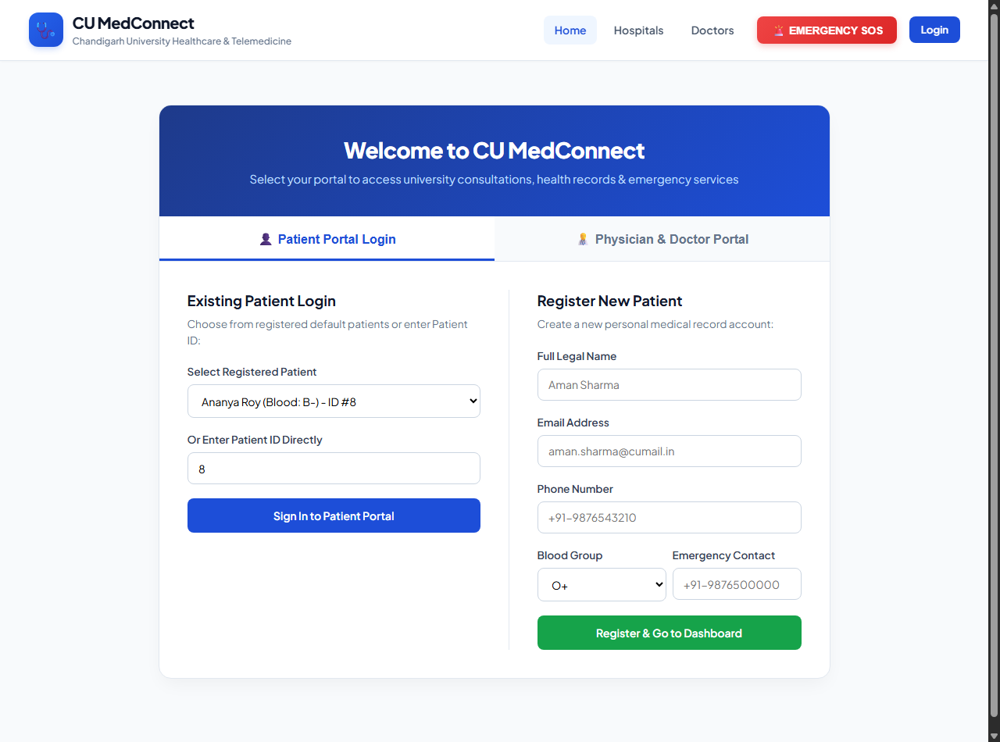
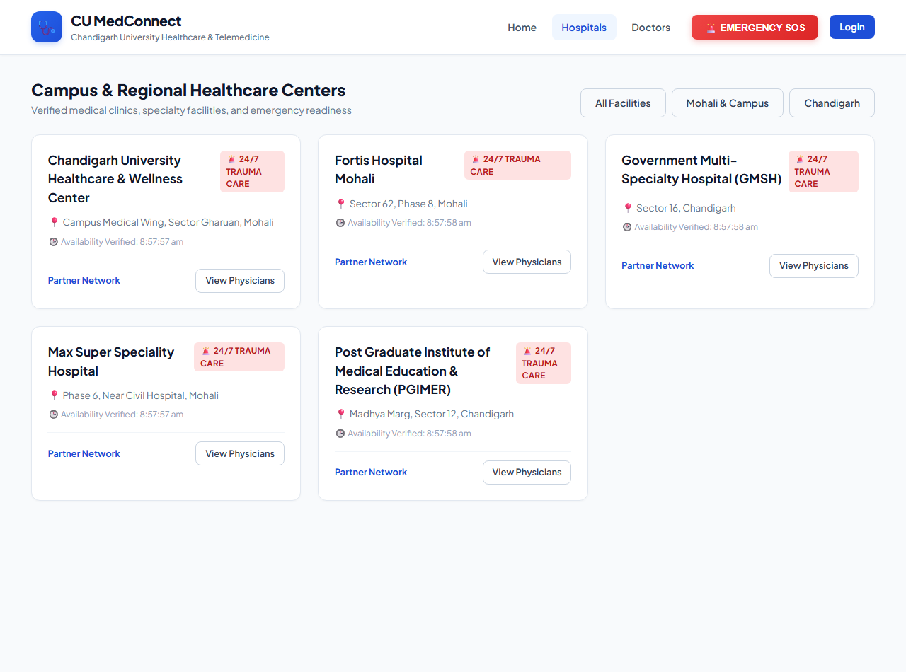

# CU MedConnect 🩺

> **Smart Campus Healthcare & Telemedicine Coordination Platform**  
> Developed at the Department of Computer Science and Engineering, Chandigarh University, Punjab, India (Academic Session 2026–2027).

---

## 📌 Overview

**CU MedConnect** is a full-stack, university-centric telemedicine and emergency coordination platform designed to eliminate healthcare logistics bottlenecks across large residential university campuses. It provides a centralized digital ecosystem for students, resident faculty, campus physicians, and medical administrators.

### 🌟 Key Pillars
- **👥 Patient Profile Management:** Self-service registration, university credential validation, blood group tracking, and emergency contact registry.
- **🏥 Healthcare Facilities Directory:** Geographically-indexed campus dispensaries and regional tertiary hospitals (Mohali & Chandigarh) with real-time 24/7 emergency service indicators.
- **👨‍⚕️ Specialist Directory:** Roster of campus physicians and visiting consultants filterable by specialization and hospital affiliation.
- **📅 Conflict-Free Appointment Booking:** High-concurrency scheduling engine enforcing zero-overlap consultation slots through database-level unique constraints (`uq_doctor_appointment_slot`), mathematically eliminating double-booking race conditions.
- **📋 Electronic Health Records (EHR):** Longitudinal clinical record archival supporting diagnoses, prescriptions, and laboratory reports.
- **🚨 Geolocation-Aware Emergency SOS:** Emergency distress logging capturing device GPS coordinates (`latitude`, `longitude`) with patient-scoped idempotency keys to prevent duplicate records during network retries.

---

## 👥 Project Contributors

| Name | Roll Number | Role |
| :--- | :---: | :--- |
| **Pratik Vats** | `24bcs10343` | Full Stack Lead & System Architect |
| **Aditya Singh** | `24bcs10266` | Backend & Database Engineer |
| **Prakash Shukla** | `24bcs10259` | Front-End & UX Engineer |
| **Shitanshu Shekhar** | `24bcs10127` | QA & Security Specialist |
| **Tarun Sharma** | `24bcs10081` | DevOps & Feasibility Analyst |

**Department of Computer Science and Engineering**  
**Chandigarh University, Gharuan, Mohali, Punjab – 140413**

---

## 📸 Screenshots & UI Walkthrough

### 1. Multi-Page Profile Selector & Authentication
Dual-role profile switcher allowing instant toggling between Student/Patient and Physician access modes, pre-seeded with project contributors and campus profiles.



### 2. Healthcare Facilities Directory
Searchable directory of campus clinics and regional multi-specialty hospitals with interactive municipal filters (Mohali, Chandigarh) and emergency trauma badges.



---

## 🛠️ Technology Stack

| Layer | Technology | Description |
| :--- | :--- | :--- |
| **Language & Platform** | Java 21 LTS | High-performance, modern typed backend runtime |
| **Framework** | Spring Boot (v4.x) | WebMVC REST controllers, Bean Validation |
| **Data Persistence** | Spring JdbcTemplate | High-throughput, parameterized SQL data access |
| **Connection Pool** | HikariCP | High-performance JDBC connection pooling |
| **Database** | MySQL 8.0 (InnoDB) | Relational store with foreign keys & unique constraints |
| **Presentation Tier** | HTML5 / CSS3 / ES6+ JS | Zero-dependency responsive interface (Plus Jakarta Sans) |
| **Build System** | Apache Maven 3.9+ | Multi-platform compilation and dependency packaging |
| **Process Wrapper** | Node.js (Optional) | Cross-platform script runner (`run.js`) |

---

## 🏛️ System Architecture

```
[ Client Browser / Mobile PWA ]
               │
               ▼ HTTP / TLS 1.3 (Port 8081)
┌─────────────────────────────────────────────────────────────────┐
│ Spring Boot Web Application Tier (Java 21 LTS)                  │
│                                                                 │
│  ├── Spring Security (Permissive Prototype Filter Chain)        │
│  ├── Jakarta Bean Validation API (@Valid, @Future, Regex)       │
│  ├── REST Domain Controllers (MedConnectApi.java)               │
│  └── Spring JdbcTemplate + HikariCP Connection Pool             │
└────────────────────────────────┬────────────────────────────────┘
                                 │ JDBC Connection (Port 3306)
                                 ▼
┌─────────────────────────────────────────────────────────────────┐
│ MySQL 8.0 InnoDB Relational Database (CuMed)                    │
│                                                                 │
│  ├── patients            (Unique email constraint)              │
│  ├── hospitals           (Indexed by municipality)              │
│  ├── doctors             (Foreign key -> hospitals.id)          │
│  ├── appointments        (Unique: doctor_id + appointment_at)   │
│  ├── medical_records     (Foreign key -> patients.id)           │
│  └── emergency_requests  (Unique: patient_id + idempotency_key) │
└─────────────────────────────────────────────────────────────────┘
```

---

## 🚀 Getting Started & Local Setup

### Prerequisites
- **JDK 21** or later installed and configured in `PATH`.
- **Apache Maven 3.9+** installed and configured in `PATH`.
- **MySQL 8.0 Server** running locally on port `3306`.
- **Node.js** (Optional, for running via `node run.js`).

### 1. Database Configuration
Ensure MySQL is running and set your credentials in `src/main/resources/application.properties` or via environment variables:

```properties
server.port=${PORT:8081}
spring.datasource.url=jdbc:mysql://localhost:3306/CuMed?createDatabaseIfNotExist=true&serverTimezone=UTC
spring.datasource.username=${DB_USERNAME:root}
spring.datasource.password=${DB_PASSWORD:pratik123}
spring.datasource.driver-class-name=com.mysql.cj.jdbc.Driver

# Auto-execute schema on startup
spring.sql.init.mode=always
spring.sql.init.schema-locations=classpath:schema.sql
```

> **Note:** The application will automatically create the `CuMed` database and execute `schema.sql` to initialize tables and seed data upon startup.

### 2. Run the Application

**Option A: Using Maven directly**
```bash
mvn spring-boot:run
```

**Option B: Using Node.js runner**
```bash
node run.js
```

### 3. Open in Browser
Once started, visit:
👉 **[http://localhost:8081/](http://localhost:8081/)**

- **Home / Profile Selector:** `http://localhost:8081/index.html`
- **Patient Dashboard:** `http://localhost:8081/patient-dashboard.html`
- **Doctor Dashboard:** `http://localhost:8081/doctor-dashboard.html`
- **Hospitals Directory:** `http://localhost:8081/hospitals.html`
- **Doctors Directory:** `http://localhost:8081/doctors.html`

---

## 📡 REST API Reference

| Method | Endpoint | Description | Status Codes |
| :---: | :--- | :--- | :---: |
| `POST` | `/api/patients` | Register a new patient account | `201`, `400`, `409` |
| `GET` | `/api/patients` | Retrieve patient directory (optional `?email=` filter) | `200` |
| `GET` | `/api/patients/{id}` | Fetch patient profile by unique ID | `200`, `404` |
| `GET` | `/api/hospitals` | List healthcare facilities (optional `?city=` filter) | `200` |
| `GET` | `/api/doctors` | List active doctors (optional `?specialization=` filter)| `200` |
| `POST` | `/api/appointments` | Book consultation (enforces slot uniqueness) | `201`, `400`, `404`, `409` |
| `GET` | `/api/appointments` | Query appointments (`?patientId=`, `?doctorId=`) | `200` |
| `GET` | `/api/appointments/{id}` | Fetch appointment by ID | `200`, `404` |
| `POST` | `/api/patients/{id}/records` | Append medical diagnosis, prescription, or lab note | `201`, `400`, `404` |
| `GET` | `/api/patients/{id}/records` | Retrieve chronological medical history for patient | `200`, `404` |
| `POST` | `/api/emergencies` | Transmit SOS coordinates with `Idempotency-Key` header | `201`, `200`, `400` |
| `GET` | `/api/emergencies/{id}` | Retrieve emergency distress ticket | `200`, `404` |

---

## 📂 Project Structure

```
CU-MedConnect/
├── .gitignore
├── pom.xml                               # Maven project configuration & dependencies
├── package.json                          # Node.js project metadata
├── run.js                                # Cross-platform runner script
├── README.md                             # Project overview & documentation
├── PROJECT_REPORT.md                     # Comprehensive academic project report (20-30 pages)
├── mpa-login.png                         # Screenshot: Profile selector & login
├── mpa-hospitals.png                     # Screenshot: Hospital directory
└── src/
    └── main/
        ├── java/com/cumedconnect/
        │   ├── MedConnectApplication.java# Spring Boot application entry point
        │   └── MedConnectApi.java        # REST API controllers, records & endpoints
        └── resources/
            ├── application.properties    # Server port, JDBC URL, pool settings
            ├── schema.sql                # MySQL 8.0 DDL schema & seed data
            └── static/                   # Static web assets
                ├── index.html            # Landing page & profile selection
                ├── patient-dashboard.html# Patient portal & consultation scheduler
                ├── doctor-dashboard.html # Physician portal, roster & EHR form
                ├── hospitals.html        # Multi-specialty hospital directory
                ├── doctors.html          # Active physician & specialist directory
                ├── css/
                │   └── style.css         # Modern medical styling & responsive layout
                └── js/
                    └── app.js            # Shared session management & navigation
```

---

## ⚠️ Medical & Emergency Disclaimer

> **IMPORTANT:**  
> CU MedConnect is an academic software engineering prototype developed for architectural evaluation and demonstration.
> - **SOS Coordination:** The emergency feature records GPS coordinates in the database and returns a status of `NOT_DISPATCHED`. It **does not** automatically dispatch campus responders or city ambulances.
> - **Real Emergencies:** In an acute medical emergency, immediately dial **112** (National Emergency Helpline) or contact campus emergency security directly.

---

## 📜 License
This project is developed for educational and research purposes under the Department of Computer Science & Engineering, Chandigarh University.
